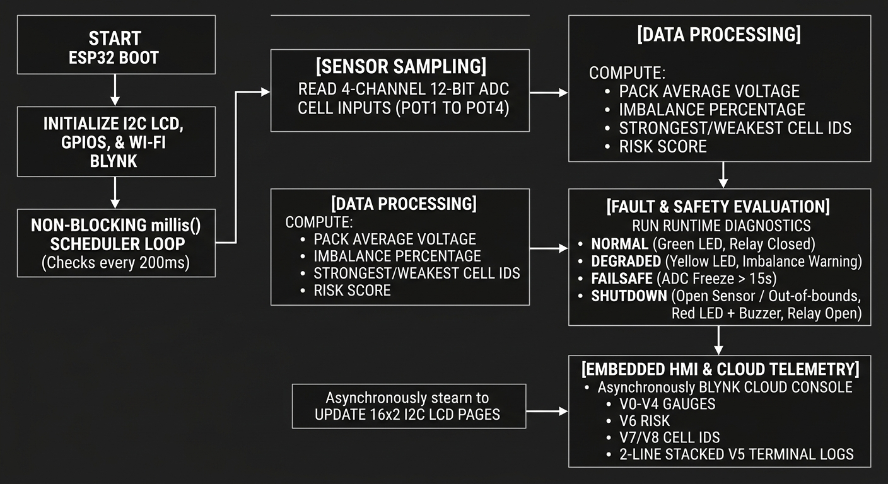
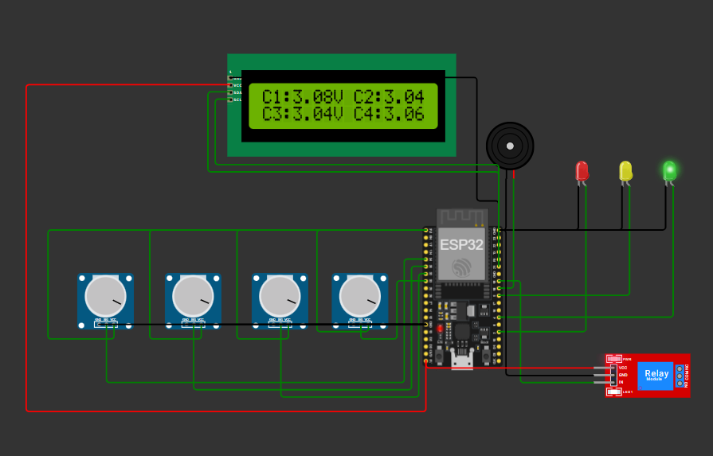
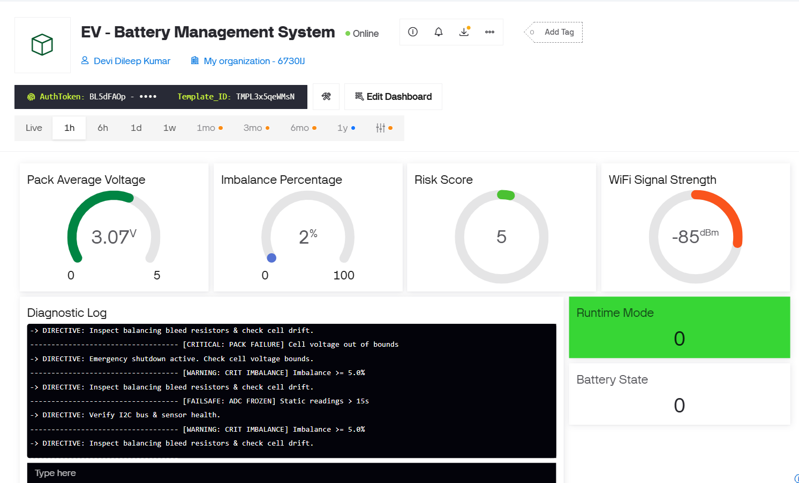

# Real-time EV Battery Management System (BMS)

An enterprise-grade, IoT-enabled Battery Management System built around an ESP32 microcontroller, featuring an event-driven safety kernel, real-time multi-cell telemetry, a fault-tolerant runtime system, and an executive-level Blynk monitoring dashboard.

> **🔥 Live Wokwi Simulation Link:** [Launch Interactive ESP32 BMS Circuit](https://wokwi.com/projects/465697769158043649)

---

## System Architecture & Features

1. **Adaptive Multi-Cell Battery Intelligence Engine:**
   - Multi-channel 12-bit ADC data acquisition across a 4-cell lithium-ion battery pack.
   - Real-time computation of individual cell voltages, pack average voltage, and imbalance percentages.
   - Dynamic identification of the strongest and weakest cells.
   - State classification into Healthy, Minor Imbalance, Critical Imbalance, and Pack Failure.
2. **Event-Driven Safety Protection Kernel:**
   - Fully non-blocking architecture relying strictly on `millis()` timing (zero blocking `delay()` functions).
   - Anti-relay chatter debounce protection and autonomous recovery logic.
   - Dynamic LED threshold triggers and buzzer warning alerts.
3. **Intelligent Embedded HMI & Diagnostic Interface:**
   - Flicker-free I2C LCD (16x2) displaying multi-page rotating metrics.
   - Automatic fault-priority screen overrides during critical anomalies.
4. **Fault-Tolerant Embedded Runtime System:**
   - Autonomous hardware/software fault isolation.
   - Frozen ADC timeout detection (15-second threshold), sensor disconnection handling, and relay mismatch monitoring.
   - Seamless runtime transitions across `NORMAL`, `DEGRADED`, `FAILSAFE`, and `SHUTDOWN` modes.
   - Timestamped local and cloud-synced fault logging.
5. **Intelligent Cloud Telemetry Architecture:**
   - Asynchronous IoT communication via the Blynk platform.
   - Optimized state-change event triggering and offline event queuing with post-reconnection synchronization.
   - Wi-Fi signal quality (RSSI) monitoring with automatic background reconnection handling.
6. **Executive Battery Intelligence Dashboard:**
   - Enterprise web console featuring live telemetry gauges (`V0`–`V4`), a real-time risk scoring engine (`V6`), and a unified diagnostic logging and operator directive terminal (`V5`).

---

## System Workflow Diagram




---

## System Architecture & Circuit Diagram

)

---

## Executive Cloud Dashboard (Blynk Console)



---

## Project Documentation & Report

* **Complete Project Report:** [`project_report.pdf`](project_report.pdf) *(Download or view the formal submission report)*

---

## Hardware Pin Mapping (Wokwi Simulation)

| Component | Pin / Channel | Description |
| :--- | :--- | :--- |
| **Cell 1 Potential Meter** | GPIO 34 (ADC1_CH6) | Simulated Cell 1 Voltage |
| **Cell 2 Potential Meter** | GPIO 35 (ADC1_CH7) | Simulated Cell 2 Voltage |
| **Cell 3 Potential Meter** | GPIO 32 (ADC1_CH4) | Simulated Cell 3 Voltage |
| **Cell 4 Potential Meter** | GPIO 33 (ADC1_CH5) | Simulated Cell 4 Voltage |
| **Red Fault LED** | GPIO 2 | Critical Fault / Shutdown Indicator |
| **Yellow Warning LED** | GPIO 5 | Degraded / Warning Indicator |
| **Green Nominal LED** | GPIO 4 | Healthy / Normal Operation Indicator |
| **Active Buzzer** | GPIO 18 | Audible Alarm Output |
| **Safety Relay Interlock**| GPIO 19 | Main Contact Disconnect Relay |
| **I2C LCD Display** | GPIO 21 (SDA), GPIO 22 (SCL) | 16x2 I2C Display (Address `0x27`) |

---

## Project Structure

```text
├── sketch.ino            # Complete integrated firmware source code
├── diagram.json          # Wokwi simulation circuit schematics and wiring
├── libraries.txt         # Required library dependencies
├── circuit_diagram.png   # Wokwi system circuit architecture screenshot
├── workflow_diagram.png  # System workflow and state transition diagram
├── blynk_dashboard.png   # Live Blynk executive dashboard screenshot
├── project_report.pdf    # Complete formal project report document
├── README.md             # Project documentation
├── bug_log.md            # Engineering bug log & troubleshooting history
├── assumptions.md        # Operational thresholds and design assumptions
└── self_attestation.md   # Completed self-attestation checklist
